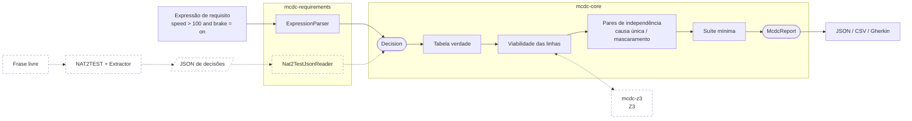
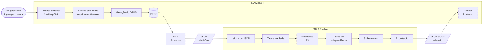

# Arquitetura da Fase 1: Motor MC/DC e Módulo de Requisitos

Complemento à "Especificação Técnica e Arquitetural: Ferramenta MC/DC Híbrida" (v1.0). Aquele documento continua valendo como visão do produto; este define o que ele deixa em aberto para começar a Fase 1.

Status: proposta. O formato do JSON de integração com a NAT2TEST é uma **proposta** até o Extractor ser construído (seção 8).

## 1. Escopo

A Fase 1 entrega uma biblioteca Java que recebe um requisito e devolve:

- a tabela verdade da decisão, marcando as linhas impossíveis;
- os pares de independência de cada condição;
- a suíte mínima de testes que atinge MC/DC;
- quando as condições comparam variáveis, valores concretos de entrada para cada teste;
- para um conjunto de testes já existente, quais condições ele cobre e a porcentagem de MC/DC (seção 10).

Entradas:

| Entrada | Exemplo | Situação |
|---|---|---|
| Expressão de requisito | `coin_sensor = true and (speed > 100 or mode = emergency)` | Principal no uso isolado. |
| JSON de decisões da NAT2TEST | Guardas do DFRS, como `(A = x /\ B = y) \/ C`, extraídas pelo Extractor | Integração (seção 8). |
| Frase livre em linguagem natural | "Quando a moeda for inserida e..." | Via NAT2TEST, que faz a análise da frase e gera o DFRS; o Extractor entrega as decisões em JSON. |

A ferramenta não faz processamento de linguagem natural por conta própria. Interpretar uma frase livre com segurança é o trabalho da NAT2TEST; a ferramenta recebe o resultado estruturado. No uso isolado, o usuário escreve o requisito na forma de expressão, que já admite comparações legíveis.

Ficam fora: análise de código Java, instrumentação, plugin Eclipse (Fases 2 a 4 do documento de visão).

## 2. Ferramenta antes do plugin

O motor é construído como biblioteca Java pura, com uma linha de comando para uso e teste. O plugin Eclipse vem depois, como uma camada fina por cima.

| | Biblioteca + CLI primeiro | Plugin primeiro |
|---|---|---|
| Testar | JUnit comum, segundos | Precisa subir uma instância do Eclipse |
| Integrar com a NAT2TEST | Direto: dependência Maven, CLI ou HTTP | Só se a NAT2TEST rodar dentro do Eclipse |
| Build | Maven comum | Tycho/OSGi, mais configuração |
| Virar plugin depois | O plugin empacota o `mcdc-core` e chama a mesma API | Extrair o motor do plugin depois é retrabalho |

### Formas de distribuição

O mesmo motor chega ao usuário de três jeitos, todos como camadas finas sobre os mesmos módulos:

| Forma | Para quem | O que é |
|---|---|---|
| Plugin no produto Eclipse da NAT2TEST | Quem já usa a NAT2TEST | Bundle OSGi que lê o JSON produzido pelo Extractor e devolve o relatório para o Viewer da NAT2TEST. |
| Ferramenta de linha de comando | Uso isolado, CI, scripts | `mcdc` no estilo do gcov: analisa requisitos e, nas Fases 2 e 3, código Java. |
| Biblioteca | Outras ferramentas Java | Dependência Maven do `mcdc-core`. |

Para o plugin funcionar sem cópia de código, os jars de `mcdc-core` e `mcdc-requirements` saem com cabeçalhos OSGi no `MANIFEST.MF` (via `bnd-maven-plugin`). O mesmo jar serve como biblioteca comum e como bundle.

No modo código, o fluxo de linha de comando segue o modelo do gcov: instrumentar, rodar os testes, gerar o relatório. Em Java isso vira um agente (`java -javaagent:mcdc-agent.jar`) que instrumenta as classes ao carregar, coleta os vetores durante os testes e grava um arquivo que o `mcdc report` lê. O JaCoCo já faz esse fluxo para cobertura de ramos, mas não mede MC/DC. O parser de código Java precisa funcionar fora do Eclipse (o `org.eclipse.jdt.core` funciona isolado, assim como o JavaParser), para servir à ferramenta de linha de comando e ao plugin.

Para a instrumentação, o caminho preferido é o do MC/DC do GCC 14 (Kvalsvik, 2025). O javac compila `&&`, `||` e `?:` em saltos condicionais que formam um diagrama de decisão binária (BDD). A partir dele se calcula, uma vez por decisão, uma tabela de mascaramento, e a coleta durante os testes vira poucas operações de bits. Em Java isso é feito no bytecode, com ASM, e serve também a Kotlin e Scala. O parser de fonte continua necessário para ligar cada salto ao texto da condição no relatório. No modo código, o curto-circuito entra como um terceiro valor por condição: "não avaliada".

## 3. Repositórios e módulos

**Um repositório só, com módulos Maven.** Motor e API mudam juntos nesta fase, e dois repositórios obrigariam a versionar e publicar o motor a cada ajuste no contrato.

```
Tool_MCDC_Java/
├── pom.xml                  (pai)
├── mcdc-core/               motor + modelo de decisão; sem dependências externas
├── mcdc-requirements/       adaptadores de entrada: expressão e JSON da NAT2TEST
├── mcdc-z3/                 viabilidade e valores concretos com o Z3
├── mcdc-cli/                comando mcdc
└── docs/
```

Módulos previstos para depois, no mesmo repositório:

| Módulo | Quando | Para quê |
|---|---|---|
| `mcdc-rest` | se a integração não for em Java | Serviço HTTP fino sobre o `mcdc-core`. |
| `mcdc-java` | Fases 2 e 3 | Parser de código Java e instrumentação. |
| `mcdc-agent` | Fase 3 | Agente Java que coleta os vetores executados durante os testes (seção 12). |

"API" aqui tem dois sentidos, e só o primeiro existe na Fase 1:

1. **API Java:** a fachada pública do `mcdc-core` (seção 5). Outra ferramenta Java integra adicionando a dependência Maven.
2. **API REST:** o módulo `mcdc-rest`, que só expõe a API Java por HTTP.

O plugin Eclipse (Fase 4) é o único candidato real a um segundo repositório, porque o build de plugin (Tycho/OSGi) é diferente do Maven comum. Ele consumiria o `mcdc-core` como dependência.

Regra de dependência: `mcdc-core` não conhece NAT2TEST, Z3 nem Eclipse. Todo o resto depende dele, nunca o contrário.

## 4. Fluxo



Os adaptadores vivem em `mcdc-requirements`. O motor só enxerga `Decision`. Tracejado indica o que vem depois do primeiro ciclo ou é externo.

O `Nat2TestJsonReader` reaproveita o `ExpressionParser` para ler as guardas: são o mesmo tipo de expressão, só com `/\` e `\/` no lugar de `and` e `or`.

### Integração com a NAT2TEST



O requisito passa pelas etapas da NAT2TEST até o DFRS. O Extractor lê o DFRS e grava um JSON só com o que o MC/DC precisa: as decisões, as entradas e seus tipos (seção 8). O plugin roda o motor e devolve o relatório em JSON ou CSV para o Viewer, o front-end da NAT2TEST. Tracejado indica o que ainda não existe.

As dependências entre os módulos estão na tabela da seção 3: todos dependem do `mcdc-core`, e ele não depende de nenhum.

## 5. Modelo de decisão e API do motor

### Modelo

```java
public sealed interface Expr permits Cond, And, Or, Not { }

public record Cond(String id, Predicate predicate) implements Expr { }  // predicate é null em condições só booleanas
public record And(Expr left, Expr right) implements Expr { }
public record Or(Expr left, Expr right) implements Expr { }
public record Not(Expr operand) implements Expr { }

/** O que uma condição afirma sobre uma variável, ex.: speed > 100. */
public record Predicate(String variable, String operator, String value) { }

public record Decision(
    String id,                         // ex.: "the_coffee_machine_system#1"
    String requirement,                // requisito de origem, para o Viewer
    String text,                       // guarda como foi escrita
    Expr expression,                   // guarda já lida
    List<String> actions               // consequente, ex.: ["atr1", "atr2"]
) { }

public record InputVariable(String name, String type, List<String> values) { }
public record DecisionSet(String system, List<InputVariable> inputs, List<Decision> decisions) { }
```

Para a tabela verdade, uma condição é atômica: o motor só sabe que `speed > 100` é verdadeira ou falsa. O `Predicate` serve para outra coisa: descobrir quais combinações são possíveis e com que valores (seção 6.2).

**Entrada e condição.** Pela definição da DO-178, cada ocorrência de uma entrada na expressão é uma condição distinta. `(A and B) or (not A and C)` tem 3 entradas (A, B, C) e 4 condições (A#1, B, A#2, C).

- A tabela verdade é montada sobre as **entradas**: 2^3 linhas no exemplo.
- Os pares de independência são calculados por **condição**: o primeiro `A` e o segundo `A` precisam, cada um, do seu par.
- `Cond(id)` continua guardando o nome da entrada; a condição é identificada pela posição da folha na árvore. O relatório só mostra o número da ocorrência (`A#2`) quando o nome se repete.
- Para condições com predicado, a entrada é o texto normalizado do predicado (`speed > 100`). A mesma comparação repetida é a mesma entrada; comparações diferentes sobre a mesma variável (`speed > 100`, `speed > 50`) são entradas diferentes, ligadas pelo Z3 (seção 6.2).

O tipo `Condition` representa cada ocorrência: posição da folha, entrada, número da ocorrência e rótulo.

### Fachada

```java
McdcReport report = Mcdc.analyze(expr, McdcOptions.defaults());
DecisionAnalysis analysis = Mcdc.analyze(decision, McdcOptions.defaults());  // decisão + relatório
```

```java
public record McdcOptions(
    McdcVariant variant,       // UNIQUE_CAUSE ou MASKING; padrão MASKING
    Expr constraint            // restrição escrita à mão, ex.: not A or B; null quando não há
) { }

public record McdcReport(
    Expr expression,
    McdcOptions options,
    TruthTable table,                                // todas as linhas, cada uma marcada como possível ou não
    Map<String, List<IndependencePair>> pairs,       // por condição, só entre linhas possíveis
    List<TestVector> minimalSuite
) {
    List<String> uncoveredConditions();              // condições sem nenhum par possível
    boolean isComplete();
}
```

Com o Z3 (seção 6.2), entra um campo `FeasibilityChecker` em `McdcOptions`. A restrição escrita à mão passa a ser uma das implementações dessa interface.

### Exemplo de saída

Para a decisão `(A and B) or C`, variante causa única:

| Vetor | A | B | C | Resultado |
|---|---|---|---|---|
| V1 | T | T | T | T |
| V2 | T | T | F | T |
| V3 | T | F | T | T |
| V4 | T | F | F | F |
| V5 | F | T | T | T |
| V6 | F | T | F | F |
| V7 | F | F | T | T |
| V8 | F | F | F | F |

| Condição | Pares de independência |
|---|---|
| A | (V2, V6) |
| B | (V2, V4) |
| C | (V3, V4), (V5, V6), (V7, V8) |

Suíte mínima: V2, V3, V4 e V6. São 4 testes para 3 condições.

## 6. Decisões sobre o algoritmo

### 6.1 Variante de MC/DC

Nomes e definições seguem Chilenski (DOT/FAA/AR-01/18) e a formalização de Kapoor e Bowen. A coluna "Detecta com garantia" vem da análise de falhas de Kapoor e Bowen: negação de subexpressão, negação de variável, troca de variável, variável ausente e troca de operador. Nenhuma variante garante detectar parênteses deslocados.

| Variante | Regra do par | Detecta com garantia | Situação |
|---|---|---|---|
| Causa única (UC) | Só a condição analisada muda entre os dois vetores, e o resultado muda. Só se aplica sem condições acopladas. | Todas as cinco | Implementada (`UNIQUE_CAUSE`, quando nenhuma entrada se repete) |
| Causa única com mascaramento fraca (UCMW) | As ocorrências da mesma entrada contam como uma condição só; basta um par para a entrada. | Não há garantia quando a entrada se repete | Não implementada (era o comportamento da primeira versão) |
| Causa única com mascaramento forte (UCMS) | Só a entrada analisada muda, e cada ocorrência precisa de um par em que é ela que decide o resultado. | Todas as cinco | Implementada (`UNIQUE_CAUSE`, quando alguma entrada se repete) |
| Mascaramento | A condição muda, o resultado muda, e nos dois vetores a ocorrência decide o resultado; as outras condições podem mudar. | Todas, menos troca de variável | Implementada (`MASKING`), por ocorrência |

**Padrão: mascaramento.** É a variante implementada no GCC 14 e no Clang, aceita na DO-178C (CAST-6), e Chilenski mostrou eficácia semelhante à da causa única. Para compensar a falta de garantia sobre troca de variável, a suíte mínima prefere pares de causa única sempre que houver um disponível (seção 6.4).

**Por ocorrência.** Em `(A and B) or (not A and C)`, o primeiro `A` só é demonstrado pelo par (TTF, FTF) e o segundo só por (TFT, FFT); a ferramenta exige os dois. A primeira versão juntava as ocorrências pelo nome, escolhia só um par para `A` e informava cobertura completa.

**RC/DC** (Reinforced Condition/Decision Coverage) não está planejada: Kapoor e Bowen mostram que os vetores extras que ela exige não aumentam a detecção de falhas em relação ao MC/DC.

O exemplo da seção 4 do documento de visão usa o par TFF/FFT para a condição C. Ele só é válido em mascaramento, porque A também muda. Em causa única o par seria TFF/TFT.

Curto-circuito não se aplica ao modo requisitos: é uma propriedade de como o código avalia a expressão. Ele volta a ser relevante no `mcdc-java`.

### 6.2 Linhas impossíveis e Z3

Condições que falam da mesma variável dependem uma da outra. Em `speed > 100 or (speed > 50 and rain = true)`, qualquer linha com `speed > 100` verdadeira e `speed > 50` falsa é impossível. No caso extremo, `the_coin_sensor = true` e `the_coin_sensor = false` nunca são verdadeiras juntas.

O motor não descarta linhas da tabela: marca cada `TestVector` como possível ou não, e só forma pares entre linhas possíveis. Assim os índices continuam valendo e o relatório consegue mostrar as linhas descartadas e o motivo.

Quem decide é um `FeasibilityChecker`, interface do `mcdc-core`:

```java
public interface FeasibilityChecker {
    /** Valores concretos que realizam a linha, ou vazio se ela for impossível. */
    Optional<Map<String, String>> solve(Decision decision, TestVector row);
}
```

| Implementação | Onde | Uso |
|---|---|---|
| Tudo possível | `mcdc-core` | Padrão. Condições puramente booleanas. |
| Restrições explícitas | `mcdc-core` | O usuário informa uma expressão que toda linha precisa satisfazer, ex.: `not A or B`. |
| Z3 | `mcdc-z3` | Usa os predicados. Descobre as linhas impossíveis sozinho. |

Com Z3, cada linha vira uma consulta: cada condição verdadeira entra como o predicado, cada falsa como a negação. Para a linha "`the_coin_sensor = true` verdadeira e `the_coin_sensor = false` verdadeira":

```smt
(declare-const the_coin_sensor Bool)
(assert (= the_coin_sensor true))
(assert (= the_coin_sensor false))
(check-sat)   ; unsat: linha impossível
```

Quando a resposta é `sat`, o Z3 também devolve um modelo (`(get-model)`), por exemplo `speed = 101, rain = false`. É isso que transforma um vetor `TTF` em um caso de teste com valores concretos de entrada, e é o que o relatório mostra.

O `mcdc-z3` gera o texto SMT-LIB e chama o executável `z3` (`brew install z3`), sem biblioteca nativa no build. São duas chamadas por decisão: uma faz `check-sat` de todas as linhas com `push`/`pop`, outra pede os valores (`get-value`) das possíveis. Uma resposta `unknown` deixa a linha como possível, sem valores. Enumerações viram inteiros de 0 a k−1 com restrição de domínio. A API Java do Z3 fica como otimização se o número de consultas pesar.

Os tipos das variáveis vêm das declarações de entrada do DFRS (`INPUTS`), repassadas pelo Extractor no JSON. No uso isolado, o tipo é inferido do valor: `true`/`false` → `Bool`, número → `Int` ou `Real`, outro texto → valor de uma enumeração. Uma enumeração inferida ganha um valor extra, `_outro`, para que "nenhum dos valores citados" também seja possível.

Efeito em `speed > 100 or (speed > 50 and rain = true)`, com A = `speed > 100`, B = `speed > 50`, C = `rain = true`:

| Condição | Tabela completa | Só linhas possíveis |
|---|---|---|
| A | 3 pares | 1 par: (TTF, FTF) |
| B | 1 par: (FTT, FFT) | igual |
| C | 1 par: (FTT, FTF) | igual |

Suíte mínima: TTF, FTF, FTT, FFT.

### 6.3 Tamanho da decisão

A tabela verdade tem 2^N linhas. O motor enumera tudo até N = 20 condições e recusa acima disso com erro claro. Requisitos reais raramente passam de 8. Com Z3, cada linha custa uma consulta; para N grande, a verificação pode ficar restrita às linhas que participam de algum par.

### 6.4 Suíte mínima

Encontrar a suíte mínima é um problema de cobertura de conjuntos. Para N pequeno, busca exata; acima de um limite a definir, heurística gulosa. O relatório indica qual foi usada.

- **Limites:** em causa única, N condições exigem pelo menos N + 1 testes. Em mascaramento o mínimo pode ser menor, com limite inferior de ⌈2√N⌉ (Chilenski, citado por Kvalsvik). O guloso atual não explora isso; a busca exata explora.
- **Preferência por causa única:** entre pares de mesmo custo, escolher o de causa única, que dá mais garantias de detecção (seção 6.1).
- **Rastreabilidade:** o relatório guarda qual par foi escolhido para cada condição, e não só a lista de vetores.

### 6.5 Condição sem par

Uma condição pode ficar sem par por dois motivos diferentes, que o relatório precisa separar:

| Motivo | Como detectar | O que significa |
|---|---|---|
| Redundante | Não há par nem na tabela completa | A entrada não influencia o resultado: o requisito pode ser simplificado ou está mal escrito. Kapoor e Bowen mostram que nenhum conjunto de testes consegue demonstrá-la. |
| Impossível | Havia par na tabela completa, mas todos usam linhas impossíveis | As restrições entre condições impedem a demonstração. Pode valer uma variante mais flexível (mascaramento) ou revisar as restrições. |

### 6.6 Valores de fronteira

Depois que o Z3 gera valores concretos, cada predicado pode ser desdobrado em classes de equivalência e fronteiras, como em Sun et al. (2017):

| Predicado | Verdadeiro vira | Falso vira |
|---|---|---|
| `M >= 0` | `M = 0` e `M > 0` | `M < 0` |
| `M <= 1000` | `M = 1000` e `M < 1000` | `M > 1000` |
| `M = x` | `M = x` | `M < x` e `M > x` |
| `M != x` | `M < x` e `M > x` | `M = x` |

Com uma tolerância σ, `M > 0` também gera o caso `M = 0 + σ`. Isso transforma os vetores T/F em casos de teste no formato que engenheiros de verificação já usam. Fica como opção (`--boundary`), porque aumenta o número de testes.

### 6.7 Validação por mutação

Para testar o próprio motor, e futuramente como relatório para o usuário, a expressão é alterada de propósito com os seis tipos de falha estudados por Kapoor e Bowen e por Hayhurst e Veerhusen: troca de operador, negação de subexpressão, negação de variável, parênteses deslocados, variável ausente e troca de variável. Para cada versão alterada, verifica-se se a suíte gerada a distingue da original. Isso confirma na prática a tabela de garantias da seção 6.1.


## 7. Expressão de requisito

É a entrada do uso isolado e também a linguagem das guardas do DFRS.

```
expr       := termo ( "or" termo )*
termo      := fator ( "and" fator )*
fator      := "not" fator | "(" expr ")" | comparacao | IDENT
comparacao := IDENT OP VALOR
OP         := "=" | "!=" | "<" | "<=" | ">" | ">="
```

| Operador | Formas aceitas |
|---|---|
| e | `and`, `&&`, `/\` |
| ou | `or`, `\|\|`, `\/` |
| não | `not`, `!` |

`not` tem precedência sobre `and`, que tem sobre `or`. Um `IDENT` sozinho é uma condição booleana sem predicado (`A`, `door_closed`).

A primeira versão do parser aceita só condições booleanas; as comparações entram no passo seguinte. Com uma gramática deste tamanho, um parser escrito à mão resolve. ANTLR 4, previsto no documento de visão, passa a compensar se a linguagem crescer (tipos, temporizadores, blocos de vários requisitos).

## 8. Integração com a NAT2TEST: Extractor e JSON

O plugin não lê o DFRS diretamente. O **Extractor** (EXT), do lado da NAT2TEST, lê o DFRS e grava um JSON com as decisões. Com isso:

- o formato de entrada do motor é definido por nós, e não depende de como a NAT2TEST guarda o DFRS internamente;
- o mesmo JSON serve para o plugin, para a linha de comando (`mcdc analyze --json`) e para os testes do motor;
- outra ferramenta de requisitos pode se integrar escrevendo o próprio extrator.

### Formato proposto do JSON de entrada

Exemplo a partir do DFRS discutido:

```
DFRS = {
  INPUTS = {A, B, C}
  FUNCTIONS = {
    the_coffee_machine_system = {
      ((A = x /\ B = y) \/ C), temporal1) |-> [atr1 ; atr2]
    }
  }
}
```

```json
{
  "system": "the_coffee_machine_system",
  "inputs": [
    { "name": "A", "type": "enum", "values": ["x", "z"] },
    { "name": "B", "type": "enum", "values": ["y", "w"] },
    { "name": "C", "type": "bool" }
  ],
  "decisions": [
    {
      "id": "the_coffee_machine_system#1",
      "requirement": "REQ-001",
      "guard": "(A = x /\\ B = y) \\/ C",
      "temporal": "temporal1",
      "actions": ["atr1", "atr2"]
    }
  ]
}
```

A guarda vai como texto, na mesma linguagem de expressão da seção 7. Assim o Extractor só copia o texto, e o motor usa o parser que já existe. No JSON, a barra invertida aparece duplicada (`\\`) por causa do escape.

| JSON | Modelo |
|---|---|
| `decisions[]` | Uma `Decision` por item |
| `id` | `Decision.id`: nome da função e posição da entrada no DFRS |
| `requirement` | Identificador do requisito de origem, repassado ao relatório para o Viewer ligar o resultado ao requisito |
| `guard` | `Decision.expression`, lida pelo `ExpressionParser` |
| Comparações como `A = x` | `Cond` + `Predicate` |
| `inputs` | Tipos e domínios das variáveis, para o Z3 |
| `actions` | `Decision.expectedAction` |
| `temporal` | Na primeira versão, uma condição booleana sem predicado |

### O que conferir com a NAT2TEST

1. **Acesso ao DFRS pelo Extractor:** modelo em memória dentro do produto Eclipse, arquivo exportado ou ponto de extensão.
2. **Rastreabilidade:** como chegar do DFRS ao identificador do requisito original, que o Viewer vai precisar.
3. **Guardas temporais e valor anterior:** como o DFRS escreve “was” e “changes to” (o valor da variável no passo anterior). Nos requisitos da VM isso foi escrito à mão como `X_antes` (passo 22 da seção 11). Timers continuam sendo variáveis numéricas comuns; tratar o tempo de verdade fica para depois.
4. **Tipos e domínios das entradas:** inclusive enumerações e intervalos numéricos.
5. **Funções com várias entradas:** se as guardas são mutuamente exclusivas, cada uma vira uma `Decision` independente.
6. **Variáveis de saída na guarda** (estado anterior do sistema): entram como condições comuns.

Só o `Nat2TestJsonReader` e o Extractor dependem desse formato. Motor e relatórios não são afetados.

### Z3 nos dois lados

A NAT2TEST já usa o Z3 como solver na geração de testes dela. Isso abre duas possibilidades para a integração:

- **Reaproveitar a codificação:** se a NAT2TEST já traduz o DFRS para o Z3 (tipos, enumerações, tempo), o plugin pode usar essa tradução em vez da do `SmtEncoding`, e a mesma instalação do Z3 dentro do produto Eclipse.
- **Alcançabilidade:** o `mcdc-z3` verifica se uma combinação é possível olhando só a guarda. Uma combinação possível ainda pode ser inalcançável quando se considera o sistema ao longo do tempo (os estados anteriores e as transições). A NAT2TEST gera testes seguindo esse comportamento; ela poderia confirmar se cada vetor da suíte mínima é alcançável e com qual sequência de passos. A ferramenta escolhe **quais** testes o MC/DC exige; a NAT2TEST diz **como** chegar neles.

## 9. Saídas

| Formato | Fase 1 | Conteúdo |
|---|---|---|
| JSON | sim | `McdcReport` completo, com `id` e `requirement` de cada decisão. É o formato que volta para o Viewer da NAT2TEST. |
| CSV dos testes (`csv`) | sim | Suíte mínima: uma linha por teste e condição, com os valores concretos do Z3. |
| CSV da tabela verdade (`truth-csv`) | sim | Tabela verdade inteira: uma linha por combinação, uma coluna por condição, saída, se é possível e se entrou na suíte. Um cabeçalho por decisão; até 4096 linhas. |
| Gherkin (`.feature`) | sim | Um cenário por vetor da suíte mínima, com os valores concretos quando houver. |
| Stubs JUnit | depois | |
| HTML / PDF | Fase 4 | |

## 10. Modo avaliação de testes existentes

Além de gerar a suíte, a ferramenta mede um conjunto de testes que já existe, por exemplo os testes gerados pela NAT2TEST ou escritos à mão. É o método de avaliação de Hayhurst e Veerhusen, automatizado.

```bash
mcdc check -f requisitos.mcdc --tests testes.csv
```

- **Entrada:** a expressão e os vetores de teste, com o valor de cada entrada e o resultado esperado.
- **Cálculo:** para cada condição, procura entre os vetores fornecidos um par válido na variante escolhida. Também confere se o resultado esperado de cada vetor bate com o que a expressão calcula.
- **Métrica:** por resultado de condição com efeito independente, como no MCDC-Star (Hu et al., 2018). Cada condição tem dois resultados, T e F, e a cobertura é a quantidade de resultados demonstrados dividida por 2 × o número de condições. É mais fiel que contar pares completos.
- **Saída:** condições cobertas, condições faltando e, para cada uma que falta, o vetor que completaria o par, usando o mesmo motor da geração.

É o mesmo cálculo que a Fase 3 aplica aos vetores coletados durante a execução dos testes.

## 11. Ordem de implementação

### Feito

1. Modelo (`Expr`) e avaliação de expressão.
2. Tabela verdade, com restrições escritas à mão marcando linhas impossíveis.
3. Pares de independência: causa única e mascaramento.
4. Suíte mínima gulosa.
5. Parser de expressão booleana.
6. Fachada `Mcdc.analyze`.
7. `mcdc-cli`, com leitura de arquivo e códigos de saída.
8. Comparações e `/\` `\/` no parser, com `Predicate` (seção 7).
9. Leitura do JSON do Extractor (`Nat2TestJsonReader`) no formato proposto na seção 8, com `Decision`, `InputVariable` e `DecisionSet`.
10. Exportação em JSON e CSV (`--format`, `-o`).
11. Condições por ocorrência: entrada separada de condição, pares por ocorrência, UCMS (seções 5 e 6.1).
12. `FeasibilityChecker` e `mcdc-z3`: linhas impossíveis a partir dos predicados e valores concretos (seção 6.2), opção `--z3`.
13. Rastreabilidade: par escolhido por condição no relatório, e preferência por pares de causa única no empate (seção 6.4).
14. Diagnóstico de condição sem par: redundante ou bloqueada pelas restrições (seção 6.5).
15. Escala: linhas guardadas como bits, avaliação sem mapas, teto de 1000 pares por condição; 20 entradas em 0,2 s (causa única) e 5 a 6 s (mascaramento).
16. Valores de fronteira com o Z3, opção `--boundary` (seção 6.6).
17. Modo avaliação, `mcdc check`, com a métrica por resultado de condição (seção 10).
18. Exportação Gherkin, em português.
19. Validação por mutação, opção `--mutation` (seção 6.7). Os testes confirmam no motor o teorema de Kapoor e Bowen: suítes de causa única detectam toda falha ORF, ENF, VNF, MVF e VRF.
20. Exportação da tabela verdade inteira em CSV, `--format truth-csv` (seção 9).
21. Validação com os 5 requisitos originais da VM (`exemplos/vm-decisoes.json`): MC/DC completo nos 5, 26 testes para 152 combinações, 4 combinações impossíveis encontradas pelo Z3 nos intervalos de timer. Resultados em `docs/resultados.md`.

### Próximos, em ordem

22. **Valor anterior e eventos na guarda.** “X was v” e “X changes to v” hoje são escritos à mão com uma variável `X_antes` (`X_antes != v /\ X = v`). Definir com a NAT2TEST como o DFRS expressa o valor anterior e aceitar essa forma no parser e no `SmtEncoding`, ligando `X` e `X_antes` à mesma variável. Depende da resposta 3 da seção 8.
23. **Verificação entre requisitos.** Hoje cada decisão é analisada sozinha. Com o Z3, conferir para um conjunto de decisões: (a) **sobreposição**, quando duas guardas podem ser verdadeiras ao mesmo tempo com ações que se contradizem; (b) **lacunas**, situações em que nenhuma guarda de uma mesma função vale. Nos requisitos da VM isso foi conferido à mão (REQ002 e REQ003 se completam; REQ004 e REQ005 compartilham o timer 30 sem conflito, porque o modo é diferente). Não depende da NAT2TEST.
24. **Integração com a NAT2TEST:** Extractor gerando o JSON da seção 8, o Viewer lendo o relatório, e a alcançabilidade dos vetores da suíte. Depende das respostas da seção 8.
25. **Plugin Eclipse.**
26. **Suíte exata** por otimização no Z3 (seção 6.4). Prioridade baixa: nos exemplos, inclusive nos 5 requisitos da VM, a escolha gulosa já chegou ao mínimo (n + 1).
27. **Pares pedidos direto ao Z3**, sem montar a tabela, para usar `--z3` com mais de 12 entradas. Prioridade baixa enquanto os requisitos tiverem poucas condições (o maior da VM tem 6).

### Pendências menores

- **Gherkin:** decidir se o formato fica na ferramenta; o uso previsto agora é só JSON e CSV.
- **Distribuição:** jar executável com o script `mcdc` e, depois, instalador com `jpackage` (seção 12).

### Fases seguintes

- **Fases 2 e 3, código Java:** curto-circuito como terceiro valor, instrumentação de bytecode com tabela de mascaramento (seção 2), `mcdc-agent` e `mcdc report`, reaproveitando o cálculo do modo avaliação.
- **Geração de testes a partir do código**, por execução simbólica como no MCDC-Star (em Java, Symbolic PathFinder) ou busca (EvoSuite). É um objetivo diferente do modo requisitos, que precisa continuar independente da implementação (Sun et al.), e fica para depois da Fase 3.

## 12. Ferramenta isolada (`mcdc-cli`)

A ferramenta isolada é um comando `mcdc`, no espírito do gcov: roda no terminal, lê arquivos e escreve relatórios, sem depender do Eclipse nem da NAT2TEST.

### Modo requisitos (Fase 1)

```bash
# um requisito direto na linha de comando
mcdc analyze "coin_sensor = true and (speed > 100 or mode = emergency)"

# vários requisitos de um arquivo, relatório em JSON
mcdc analyze -f requisitos.mcdc --format json -o relatorio.json

# suíte mínima em CSV
mcdc analyze -f requisitos.mcdc --format csv -o suite.csv

# viabilidade e valores concretos com Z3 (precisa do z3 instalado)
mcdc analyze -f requisitos.mcdc --z3

# decisões extraídas da NAT2TEST pelo Extractor
mcdc analyze --json decisoes.json
```

Arquivo de requisitos: um por linha, com identificador:

```
# requisitos.mcdc
REQ-001: coin_sensor = true and (speed > 100 or mode = emergency)
REQ-002: door = closed and not obstacle
```

Códigos de saída, para uso em CI:

| Código | Significado |
|---|---|
| 0 | Análise concluída; toda condição tem par de independência. |
| 1 | Erro de entrada (expressão inválida, arquivo não encontrado). |
| 2 | Análise concluída, mas alguma condição não tem par (redundante ou só com linhas impossíveis). |

### Modo código (Fases 2 e 3)

Mesmo fluxo do gcov, em que o programa instrumentado grava os dados de execução e o `gcov` gera o relatório a partir deles:

```bash
# 1. rodar os testes com o agente, que instrumenta as classes ao carregar
mvn test -DargLine="-javaagent:mcdc-agent.jar=output=target/mcdc.exec"

# 2. gerar o relatório a partir dos vetores coletados
mcdc report --exec target/mcdc.exec --classes target/classes --sources src/main/java --format html
```

| gcov (C/C++) | `mcdc` (Java) |
|---|---|
| Compilar com `--coverage` | Rodar com `-javaagent:mcdc-agent.jar` |
| Arquivos `.gcda` gravados na execução | `mcdc.exec` gravado na execução |
| `gcov arquivo.c` | `mcdc report` |

Um `mcdc-maven-plugin`, como o do JaCoCo, pode depois esconder o passo 1 na configuração do `pom.xml`.

### Distribuição

| Forma | O usuário precisa | Quando |
|---|---|---|
| Jar executável + script `mcdc` | Java 21+ instalado | Primeira versão. |
| Instalador com `jpackage` (`.pkg`, `.msi`, `.deb`) | Nada: o runtime Java vai junto | Para distribuir a quem não tem Java. |
| Binário nativo com GraalVM `native-image` | Nada; inicia instantaneamente, como o gcov | Opcional. Vale para o modo requisitos; o agente continua sendo um jar, porque roda dentro da JVM dos testes. |

Para ler os argumentos de linha de comando, a biblioteca picocli resolve subcomandos, opções e mensagens de ajuda, e é compatível com `native-image`.

## 13. Em aberto

- Formato final do JSON entre o Extractor e o plugin, e como o Extractor acessa o DFRS (seção 8).
- Formato do relatório que o Viewer da NAT2TEST vai consumir: o JSON, o `truth-csv` ou os dois.
- Notação do valor anterior (“was”, “changes to”) no DFRS (seção 8, item 3).
- Como a NAT2TEST usa o Z3 (API Java ou executável, codificação do DFRS) e se ela pode verificar a alcançabilidade dos vetores da suíte (seção 8).
- `groupId` e nome de pacote definitivos. O esqueleto usa `io.github.rvdomingos.mcdc`.
- Java: todos os módulos compilados para 21 (LTS), para o plugin rodar no produto Eclipse da NAT2TEST. Falta confirmar a versão de Java desse produto (Help → About → Installation Details → Configuration, linha `java.version`): se for 21 ou mais nova, nada muda. A CLI distribuída com runtime próprio (seção 12) não depende disso.

## 14. Referências

- Hayhurst, K. J.; Veerhusen, D. S. *A Practical Approach to Modified Condition/Decision Coverage*. 20th Digital Avionics Systems Conference, 2001. Definições da DO-178, regras mínimas por operador, método de avaliação em 5 passos, sensibilidade a erros.
- Kapoor, K.; Bowen, J. P. *A Formal Analysis of MCDC and RCDC Test Criteria*. London South Bank University. Definições formais de UC, UCMW, UCMS e mascaramento; garantias de detecção por tipo de falha; RC/DC.
- Kvalsvik, J. *Modified Condition/Decision Coverage in the GNU Compiler Collection*. arXiv:2501.02133, 2025. Mascaramento por BDD sobre o grafo de fluxo de controle; coleta com conjuntos de bits.
- Sun, Y. et al. *Functional Requirements-Based Automated Testing for Avionics*. arXiv:1707.01466, 2017. MC/DC sobre requisitos com predicados, valores de fronteira e geração de vetores por verificação de modelos.
- Hu, L.; Wong, W. E.; Kuhn, D. R.; Kacker, R. N. *MCDC-Star: A White-Box Based Automated Test Generation for High MC/DC Coverage*. DSA, 2018. Métrica por resultado de condição com efeito independente; geração de testes por execução simbólica.
- Chilenski, J. J. *An Investigation of Three Forms of the Modified Condition Decision Coverage (MCDC) Criterion*. DOT/FAA/AR-01/18, 2001. Citado pelos anteriores; origem das variantes.
