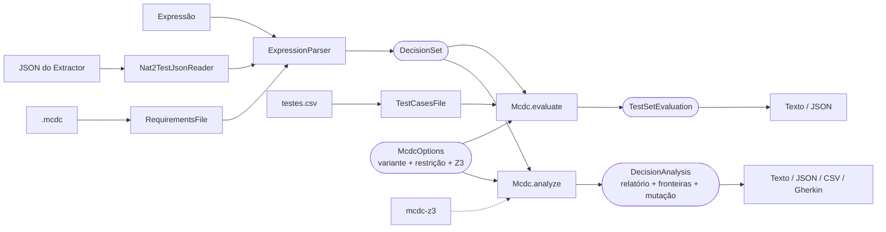

# Implementação da Fase 1: estado atual

O que existe hoje no repositório, como funciona e o que falta. A arquitetura planejada está em [arquitetura-fase1.md](arquitetura-fase1.md); este documento descreve o que já foi construído dela.

## 1. Resumo

A ferramenta tem dois modos.

**`mcdc analyze`** recebe requisitos escritos como expressão lógica e devolve, para cada decisão:

- a tabela verdade sobre as entradas, com as linhas impossíveis marcadas;
- os pares de independência de cada condição, contando cada ocorrência de uma entrada como uma condição (DO-178), em causa única ou mascaramento;
- uma suíte mínima de testes e, para cada condição, qual par da suíte a demonstra;
- para condições sem par, o motivo: redundante ou bloqueada pelas restrições;
- com o Z3, as linhas impossíveis descobertas a partir dos predicados, valores concretos para cada teste e variantes de fronteira;
- opcionalmente, a validação por mutação: quantas versões do requisito com uma falha a suíte detecta.

**`mcdc check`** recebe testes já existentes, por exemplo os gerados pela NAT2TEST, e diz quais condições eles demonstram, a porcentagem pela métrica do MCDC-Star, que teste falta para cada condição e quais resultados esperados divergem da guarda.

As entradas podem ser uma expressão avulsa, um arquivo `.mcdc` ou o JSON de decisões que o Extractor vai gerar a partir do DFRS da NAT2TEST. O relatório sai em texto, JSON, CSV dos testes, CSV da tabela verdade (`truth-csv`) ou Gherkin. São 95 testes automatizados, todos passando com JDK 21 (os 12 do Z3 são pulados se ele não estiver instalado).

```bash
./mcdc analyze '(A = x /\ B = y) \/ C'
./mcdc analyze --json exemplos/decisoes.json --z3 --boundary --format gherkin -o suite.feature
./mcdc analyze "A and (B or C)" --mutation
./mcdc check --json exemplos/decisoes.json --tests exemplos/testes.csv
```

## 2. Decisões tomadas até aqui

| Decisão | Motivo |
|---|---|
| Um repositório, vários módulos Maven | Motor e API ainda mudam juntos; o plugin Eclipse é o único candidato a repositório separado. |
| Java 21 | O plugin vai rodar dentro do produto Eclipse da NAT2TEST; 21 é a versão LTS mais segura para isso. |
| Ferramenta (biblioteca + linha de comando) antes do plugin | Testes rápidos sem Eclipse; o plugin vira uma camada fina sobre a mesma API. |
| Entrada por expressão, integração por JSON | Interpretar frase livre é o trabalho da NAT2TEST. Um Extractor lê o DFRS gerado por ela e entrega as decisões em JSON; o plugin devolve o relatório para o Viewer da NAT2TEST. |
| Cada ocorrência de uma entrada é uma condição | Definição da DO-178, formalizada por Kapoor e Bowen. Sem isso, em `(A and B) or (not A and C)` só um dos dois `A` seria demonstrado. |
| Mascaramento como variante padrão | Aceito na DO-178C (CAST-6), usado pelo GCC 14 e pelo Clang. Causa única continua disponível, e a suíte prefere pares de causa única no empate. |
| Linhas impossíveis marcadas, não removidas | Os índices das linhas continuam valendo, e o relatório mostra o que foi descartado e por quê. |
| Linhas guardadas como bits | Cada linha guarda só o índice; os valores saem dos bits. Permite 20 entradas (1 milhão de linhas) em poucas centenas de megabytes. |
| Jackson só fora do core | O `mcdc-core` continua sem dependências externas. |
| Z3 pelo executável, em módulo próprio | O `mcdc-z3` gera SMT-LIB e chama o `z3`; não há biblioteca nativa no build, e o core só conhece a interface `FeasibilityChecker`. |

## 3. Estrutura

```
Tool_MCDC_Java/
├── pom.xml                  pai: Java 21, JUnit 5, Jackson, verificação da versão do JDK
├── mcdc                     script que roda a ferramenta a partir das classes compiladas
├── exemplos/
│   ├── requisitos.mcdc      três requisitos de exemplo
│   ├── decisoes.json        quatro decisões no formato do Extractor (máquina de café)
│   └── testes.csv           testes existentes para o modo avaliação, com uma divergência de propósito
├── mcdc-core/               motor; não depende de nenhuma biblioteca
├── mcdc-requirements/       parser; leitura de .mcdc, do JSON da NAT2TEST e de testes em CSV
├── mcdc-z3/                 viabilidade, valores concretos e fronteiras com o Z3
├── mcdc-cli/                comandos analyze e check; relatórios em texto, JSON, CSV e Gherkin
└── docs/
```

Dependências: `mcdc-cli` → `mcdc-requirements` e `mcdc-z3` → `mcdc-core`.



## 4. Componentes

### `mcdc-core`

**Modelo (`core.model`)**

| Classe | Papel |
|---|---|
| `Expr` | Interface selada da expressão: `Cond`, `And`, `Or` ou `Not`. Avalia, lista as entradas sem repetição (`inputs`) e as folhas com repetição (`leaves`). |
| `Cond`, `And`, `Or`, `Not` | Nós da árvore. `Cond` guarda o nome da entrada e, quando é uma comparação, o `Predicate`. |
| `Predicate` | Variável, operador e valor (`speed > 100`). `holds` avalia o predicado com valores concretos, usado pelo modo avaliação. |
| `ExprText` | Escreve uma expressão como texto, com parênteses só onde a precedência exige. |
| `Decision`, `InputVariable`, `DecisionSet` | Decisão (id, requisito, texto, expressão, ações), variáveis declaradas e o conjunto de decisões de um sistema. |

**Entradas e condições (`Condition`)**

Uma **entrada** é uma variável da expressão; uma **condição** é cada ocorrência dela. `Condition.decides(expr, linha)` responde se aquela ocorrência decide o resultado na linha, invertendo só a folha correspondente.

**Tabela verdade (`TruthTable`, `TestVector`)**

A tabela é montada sobre as entradas. Cada linha é um número de N bits (0 = verdadeira), e o `TestVector` guarda só o índice, o resultado, se é possível e os valores concretos do Z3. Os valores das entradas saem dos bits (`value`, `values`, `bits`), e a lista de entradas é compartilhada. A avaliação também é feita direto sobre os bits. Com isso, 20 entradas (1.048.576 linhas) levam 0,2 s em causa única e 5 a 6 s em mascaramento, com cerca de 330 MB.

**Pares de independência (`IndependencePairs`, `IndependencePair`)**

| Variante | Como o código encontra o par de uma condição |
|---|---|
| Causa única | Linha com a entrada verdadeira e a gêmea com só aquele bit trocado; é par se as duas são possíveis, o resultado muda e a condição decide nas duas. UC sem repetição, UCMS com repetição. |
| Mascaramento | Linhas possíveis em que a condição decide, combinando uma com a entrada verdadeira e outra com a entrada falsa, de resultados opostos. |

Cada condição guarda no máximo 1000 pares (`MAX_PAIRS_PER_CONDITION`); no mascaramento o número de pares cresce como o produto de duas listas. `IndependencePair.isUniqueCause()` diz se os dois vetores diferem só na entrada da condição.

**Suíte mínima (`MinimalSuite`)**

Algoritmo guloso: trata primeiro as condições com menos pares e, para cada uma, escolhe o par que acrescenta menos vetores novos; no empate, prefere o de causa única. `select` devolve os vetores e o par escolhido para cada condição (`Selection.chosen`), que é a rastreabilidade: "V2 e V6 demonstram A".

**Condição sem par (`UncoveredCondition`)**

Para cada condição sem par, o motor refaz a busca na tabela sem as linhas impossíveis (`TruthTable.withoutConstraints`). Sem par mesmo assim, ela é **redundante** (não muda o resultado em nenhuma combinação; o requisito pode ser simplificado). Com par, ela está **bloqueada** pelas restrições, e o relatório mostra os pares que seriam possíveis.

**Viabilidade (`FeasibilityChecker`)**

Interface que recebe a expressão e as linhas e devolve, para cada uma, os valores concretos ou "impossível". Implementada no `mcdc-z3`.

**Fachada (`Mcdc`, `McdcOptions`, `McdcReport`, `DecisionAnalysis`)**

`Mcdc.analyze(expr, options)` devolve um `McdcReport` com tabela, pares, suíte, par escolhido por condição e condições sem par com o motivo. `Mcdc.analyze(decision, options)` devolve um `DecisionAnalysis`, que junta a decisão, o relatório e, quando pedidas, as variantes de fronteira e a validação por mutação. `McdcOptions` traz a variante, a restrição opcional e o verificador de viabilidade opcional.

**Modo avaliação (`TestCase`, `TestSetEvaluation`, `Mcdc.evaluate`)**

`TestCase.resolve` monta um teste a partir do que veio do arquivo: cada entrada vem direto com T/F ou é calculada pelo predicado a partir dos valores concretos (`speed = 101`). `Mcdc.evaluate` localiza cada teste na tabela e devolve:

- para cada condição demonstrada, o par formado por testes existentes (preferindo causa única);
- para cada condição que falta, as linhas a acrescentar, escolhidas para aproveitar os testes que já existem;
- as condições que nenhum teste consegue demonstrar, com o motivo;
- a porcentagem pela métrica do MCDC-Star: cada condição tem dois resultados (T e F), e conta o resultado que algum teste mostra com efeito independente;
- os problemas: resultado esperado diferente do que a guarda calcula, ou teste numa combinação impossível.

**Validação por mutação (`core.mutation`)**

`Mutants.of` gera as versões com uma falha, nos seis tipos de Kapoor e Bowen: troca de operador (ORF), negação de subexpressão (ENF), negação de variável (VNF), parênteses deslocados (ASF), variável ausente (MVF) e troca de variável (VRF). `MutationReport.of` confronta cada uma com a suíte: equivalente à original (nenhuma linha possível a distingue), detectada (por qual teste) ou não detectada.

### `mcdc-requirements`

| Classe | Papel |
|---|---|
| `ExpressionParser` | Texto em `Expr` por descida recursiva. Aceita `and`/`&&`/`/\`, `or`/`\|\|`/`\/`, `not`/`!`, parênteses e comparações (`=`, `==`, `!=`, `<`, `<=`, `>`, `>=`) com nomes, números e valores de enumeração. |
| `RequirementsFile` | Arquivo `.mcdc`: um requisito por linha, `ID: expressão`, com comentários `#`. |
| `Nat2TestJsonReader` | JSON do Extractor (seção 8 da arquitetura). A guarda temporal entra ligada por "e" à guarda de dados. |
| `TestCasesFile` | Testes existentes em CSV, uma linha por (teste, entrada). Colunas `test`, `input`, `value`; opcionais `decision` e `expected_outcome`. Aceita o próprio CSV exportado pela ferramenta. |

### `mcdc-z3`

| Classe | Papel |
|---|---|
| `Z3FeasibilityChecker` | Chama o executável `z3`. Para cada lote de consultas são duas chamadas: `check-sat` de todas, e `get-value` das possíveis. Verifica as linhas da tabela (até 4096, ou seja, 12 entradas) e gera as variantes de fronteira (`boundaryTests`). |
| `SmtEncoding` | Declara as variáveis (tipos do JSON ou inferidos; enumerações viram inteiros, com `_outro` quando não declaradas) e escreve a fórmula de cada entrada. Calcula os pontos de fronteira de cada comparação numérica: `speed > 100` verdadeira dá `speed = 101`, falsa dá `speed = 100`; em reais, o passo é 0,01. |
| `SExpr` | Leitor mínimo das respostas do Z3. |

### `mcdc-cli`

| Classe | Papel |
|---|---|
| `Main` | Comandos `analyze` e `check`, opções e códigos de saída. |
| `TextReport` | Texto: tabela (até 64 linhas), pares, suíte com "demonstra", demonstração por condição, fronteiras, mutação e motivo de cada condição sem par. |
| `JsonReport` | JSON para o Viewer: por decisão, rastreabilidade (`id`, `requirement`), entradas com predicados, condições, tabela (até 4096 linhas), pares, `chosenPairs`, suíte com `demonstrates` e `assignment`, `uncovered` com motivo, `boundaryTests`, `mutation`. |
| `CsvReport` | Suíte em CSV, uma linha por (decisão, teste, entrada), com `demonstrates` e `concrete_values`; as variantes de fronteira entram como testes próprios. |
| `TruthTableCsvReport` | Tabela verdade inteira em CSV (`--format truth-csv`): uma linha por combinação, uma coluna por condição, `outcome`, `feasible`, `in_suite`, `demonstrates` e `concrete_values`. Um cabeçalho por decisão; até 4096 linhas. |
| `GherkinReport` | Suíte em Gherkin, em português (`# language: pt`), um cenário por teste e por variante de fronteira, com as ações do DFRS. |
| `CheckReport` | Relatório do modo avaliação, em texto e JSON. |

| Opção | Efeito |
|---|---|
| `"<expressão>"`, `-f <arquivo.mcdc>`, `--json <arquivo.json>` | Fonte das decisões; exatamente uma. |
| `--tests <arquivo.csv>` | Testes existentes; obrigatório no `check`. |
| `--unique-cause` | Causa única em vez de mascaramento. |
| `--constraint "<expressão>"` | Restrição entre condições; só com expressão direta. |
| `--z3` | Linhas impossíveis e valores concretos com o Z3. |
| `--boundary` | Com `--z3`, variantes de fronteira (só `analyze`). |
| `--mutation` | Validação por mutação (só `analyze`). |
| `--format text\|json\|csv\|gherkin` | Formato do relatório; `check` aceita `text` e `json`. |
| `-o <arquivo>` | Grava o relatório no arquivo. |

| Código de saída | Significado |
|---|---|
| 0 | Toda condição tem par (`analyze`) ou foi demonstrada pelos testes, sem divergências (`check`). |
| 1 | Entrada inválida. |
| 2 | Alguma condição ficou sem par ou sem demonstração, ou algum resultado esperado diverge. |

O script `./mcdc` usa as classes compiladas e o classpath que o Maven grava em `mcdc-cli/target/classpath.txt` durante o `mvn compile`.

## 5. Exemplos

**Rastreabilidade.** `(A and B) or C`:

```
Suíte mínima (4 testes):
  V2  TTF  -> T   demonstra A, B
  V3  TFT  -> T   demonstra C
  V4  TFF  -> F   demonstra B, C
  V6  FTF  -> F   demonstra A

Demonstração por condição:
  A: V2 (T) e V6 (F), só ela muda
  B: V2 (T) e V4 (F), só ela muda
  C: V3 (T) e V4 (F), só ela muda
```

**Condição sem par.** `A or B` com a restrição `A or B` (a linha FF é impossível):

```
Cobertura MC/DC: incompleta, sem par para A, B
  A: bloqueada pelas restrições: os pares (V2, V4) usam linhas impossíveis
  B: bloqueada pelas restrições: os pares (V3, V4) usam linhas impossíveis
```

No `exemplos/requisitos.mcdc`, o REQ-003 mostra o outro caso: `freio_acionado#2` e `pedal_pressionado` são redundantes.

**Z3 e fronteiras.** `speed > 100 or (speed > 50 and rain)`, causa única, `--z3 --boundary`: a suíte V2, V5, V6, V7 ganha valores concretos (`speed = 101`, `speed = 51`, `speed = 0`) e as variantes `speed = 101` (V2), `speed = 100` e `speed = 51` (V5 e V6) e `speed = 50` (V7). V2 não admite `speed = 51` porque contradiz `speed > 100`.

**Validação por mutação.** `A and (B or C)`: a suíte detecta todas as falhas menos a de parênteses deslocados, `A and B or C`. É o exemplo de Hayhurst e Veerhusen: a suíte (TTF, TFT, TFF, FTF) é exatamente a do artigo, e nenhuma variante de MC/DC garante detectar esse tipo de falha.

```
Validação por mutação: 94,1% das falhas detectáveis foram detectadas
  troca de operador (ORF): 2 de 2
  negação de subexpressão (ENF): 2 de 2
  negação de variável (VNF): 3 de 3
  parênteses deslocados (ASF): 0 de 1
  variável ausente (MVF): 3 de 3
  troca de variável (VRF): 6 de 6
  não detectada: ASF A and B or C
```

**Modo avaliação.** `./mcdc check --json exemplos/decisoes.json --tests exemplos/testes.csv`, decisão 3:

```
Testes:    2
  T3 = V2  TTF  -> T
  T4 = V6  FTF  -> F

Condições:
  the_system_mode = choice: demonstrada por T3 (T) e T4 (F)
  the_coffee_request_button = true: falta; acrescente V4 (TFF -> F)
  the_coin_sensor = true: falta; acrescente V5 (FTT -> T)

Problemas:
  T4: resultado esperado T, mas a guarda dá F para esses valores

Resultados de condição demonstrados: 4 de 6 (66,7%)
Cobertura MC/DC: incompleta, 1 de 3 condições demonstradas
```

A suíte exportada pela própria ferramenta (`--format csv`) volta pelo `check` com 100%.

## 6. Testes

| Classe de teste | Testes | O que garante |
|---|---|---|
| `ExprTest` | 4 | Avaliação; condição sem valor; entradas e folhas. |
| `ConditionTest` | 2 | Numeração das entradas repetidas; inverter uma ocorrência não inverte a outra. |
| `TruthTableTest` | 8 | Linhas, resultados, limite de 20 entradas, linhas impossíveis; valores a partir dos bits; 20 entradas em menos de 30 s. |
| `IndependencePairsTest` | 8 | Pares de causa única e de mascaramento, negação, redundância, linhas impossíveis, pares por ocorrência. |
| `MinimalSuiteTest` | 4 | Tamanho das suítes; par escolhido por condição; preferência por causa única no empate. |
| `McdcTest` | 6 | Fachada; ocorrência redundante; restrição e variante; um par por ocorrência; diagnóstico redundante e bloqueado. |
| `TestSetEvaluationTest` | 6 | Suíte completa; sugestão do que falta; métrica por resultado de condição; resultado esperado errado; valores concretos pelos predicados; comparação de números e nomes. |
| `MutationReportTest` | 5 | O teorema de Kapoor e Bowen no nosso motor (suítes de causa única detectam toda falha ORF, ENF, VNF, MVF e VRF em 6 expressões); todos os tipos de falha gerados; o exemplo de parênteses deslocados; mutantes equivalentes; texto das expressões. |
| `ExpressionParserTest` | 9 | Parênteses, precedência, símbolos, comparações, operadores do DFRS, erros. |
| `RequirementsFileTest` | 3 | Arquivo `.mcdc`. |
| `Nat2TestJsonReaderTest` | 4 | JSON do Extractor. |
| `TestCasesFileTest` | 4 | CSV de testes por decisão; CSV exportado pela ferramenta; sem coluna `decision`; colunas faltando. |
| `Z3FeasibilityCheckerTest` | 12 | Linhas impossíveis, valores concretos, mesmo resultado da restrição manual, enumerações, booleanos, reais, duas variáveis, tipo errado, Z3 ausente, variantes de fronteira inteiras e reais. Pulados sem o `z3`. |
| `MainTest` | 11 | Códigos de saída; fontes; formatos, inclusive `truth-csv`; gravação em arquivo; `check`; validação das opções; mutação e Gherkin. |
| `JsonReportTest` | 3 | Rastreabilidade e resultados; predicados; condições sem par. |
| `CsvReportTest` | 2 | Uma linha por teste e entrada, com `demonstrates`; aspas. |
| `GherkinReportTest` | 1 | Cenários em português com condições e ações. |
| `TruthTableCsvReportTest` | 3 | Uma linha por combinação e uma coluna por condição; linhas impossíveis; um cabeçalho por decisão. |

## 7. Limitações conhecidas

| Limitação | Efeito | Como resolver |
|---|---|---|
| Algoritmo guloso | Pode passar do mínimo em alguns casos | Suíte exata por otimização no Z3 (passo 26 do roteiro; guia de estudos, módulo 6) |
| Z3 linha a linha | Aceita até 12 entradas (4096 linhas) | Pedir os pares direto ao Z3, sem montar a tabela (guia de estudos, módulo 8) |
| Mascaramento com 20 entradas | 5 a 6 s, porque testa cada condição em cada linha | A mesma consulta direta ao Z3, ou calcular a tabela de mascaramento pela estrutura, como o GCC |
| Diagnóstico sem a causa exata | "Bloqueada" diz quais pares as restrições impedem, mas não qual predicado contradiz qual | Unsat core do Z3 (guia de estudos, módulo 5) |
| Modo avaliação sem `--boundary` e `--mutation` | Só mede pares e resultados de condição | Medir também se os testes existentes detectam as mutações |

Na Fase 2 (código Java), o motor precisa ainda de um terceiro valor por condição para o curto-circuito ("não avaliada").

## 8. Próximos passos

A ordem completa está na seção 11 do documento de arquitetura. Os próximos:

1. Suíte exata por otimização no Z3.
2. Pares pedidos direto ao Z3, para escala com `--z3`.
3. Integração com a NAT2TEST: Extractor gerando o JSON, Viewer lendo o relatório, alcançabilidade dos vetores.
4. Plugin Eclipse.

## 9. Como rodar

```bash
export JAVA_HOME=$(/usr/libexec/java_home -v 21)
mvn clean verify                     # compila e roda os 95 testes
./mcdc analyze "(A and B) or C"
```

Sem argumentos, `./mcdc` mostra as opções. No Eclipse, os cinco projetos (`mcdc-parent`, `mcdc-core`, `mcdc-requirements`, `mcdc-z3`, `mcdc-cli`) são importados como Existing Maven Projects; depois de mudanças feitas fora do Eclipse, basta F5, e Maven → Update Project quando um `pom.xml` mudar.
